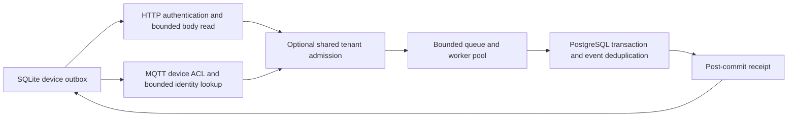

# FleetCore

[](https://github.com/Jappynathaniel/FleetCore/actions/workflows/ci.yml)
[](LICENSE)

FleetCore is a Rust backend for connected-vehicle telemetry. Vehicles can buffer data in a durable local outbox, send it over HTTP or MQTT, and replay it when connectivity returns. Operators can query current state and event history within their tenant.

## Run the demo

Use Docker with Compose v2 and BuildKit. Run these commands from the repository root:

```sh
docker compose up -d --build --wait api prometheus
docker compose run --rm simulator generate --events 3
docker compose run --rm simulator flush --via http
docker compose run --rm simulator generate --events 5
docker compose run --rm simulator flush --via mqtt
docker compose run --rm simulator inspect
```

On a POSIX shell, `sh scripts/demo.sh` also stops the API, records telemetry during the outage, restarts the API, and replays the persistent backlog over MQTT from a fresh simulator container. `docker compose run --rm simulator drive --via mqtt` records one sample every ten seconds while a separate task replays the outbox.

API and metrics are available on `localhost:8080` and Prometheus on `localhost:9090`. The seeded synthetic fixtures are `north-van` / `north-van-demo` / `north-operator-demo`, and their `south` equivalents. HTTP uses bearer tokens. MQTT authenticates with device ID and device token. The Compose credentials and plaintext listeners are intended for the localhost demo.

## Interfaces

- `POST /v1/telemetry/batches` accepts a JSON object with `batch_id` and `events`. Event fields are `event_id`, `observed_at_ms`, `latitude_e6`, `longitude_e6`, and `speed_cm_s`. IDs are UUIDs. Event limits are 1 to 10,000 and the payload limit is 2 MiB.
- MQTT publishes the same JSON to `devices/{device_id}/telemetry` at QoS 1. Wait for a `committed` receipt on `devices/{device_id}/receipts` before dropping the outbox entry. Receipts carry the batch ID, outcome, inserted count, and duplicate count for distinct IDs.
- `GET /v1/vehicles/{device_id}/latest` returns the most recent observation, or HTTP 204 for an empty history. `GET /v1/vehicles/{device_id}/telemetry?limit=100` returns events and an optional `next_cursor`. Pass that cursor back as `cursor` to continue. Ordering is descending by observation time and event ID.
- Retry HTTP 429 or 5xx and MQTT `busy` or `unavailable` with the original event IDs. An ID reused with a different event payload rejects the whole batch. HTTP uses 409 for this conflict.

## Verify behavior

CI runs on pushes to `main` and pull requests. It checks formatting, denies Clippy warnings across every target, runs unit tests, and exercises the Compose acceptance suite under both SQL writers with tenant admission enabled and disabled. The acceptance suite includes PostgreSQL and MQTT broker outage/replay checks. Each job uses disposable data, bounded build concurrency, a timeout and read-only repository permissions.

With Rust 1.95.0 and its `rustfmt` and `clippy` components installed, run the code checks locally:

```sh
cargo fmt --all --check
cargo clippy --locked --all-targets --all-features -- -D warnings
cargo test --locked --all-targets --all-features
cargo test --locked --doc
```

Run `sh scripts/acceptance.sh` against a disposable Compose project. It exercises both transports, concurrent replay, rollback, cross-tenant access, queue saturation and outage recovery. Use a dedicated project name if retaining demo data:

```sh
COMPOSE_PROJECT_NAME=fleetcore-check HTTP_PORT=18080 MQTT_PUBLISHED_PORT=11883 sh scripts/acceptance.sh
```

The bounded queue rejects excess work and feeds a fixed worker pool backed by PostgreSQL. Database commits precede application receipts. The history index supplies both latest state and chronological reads. These guarantees are shared across transports.



Run `docker compose down` to stop the demo and keep its volumes.

## Benchmark ingestion

The benchmark Compose stack limits PostgreSQL to two CPUs and 1 GiB, and each API/load-generator container to two CPUs and 768 MiB. Results below are controlled local measurements with synthetic devices and one API instance.

Run `docker compose -f compose.bench.yaml up -d --build --wait api-copy`, then `docker compose -f compose.bench.yaml run -T --rm benchmark`. On a POSIX shell, `sh scripts/benchmark.sh` runs both commands. Add `--scenario reconnect --layer http` to focus on 1,000 devices replaying 360,000 events. The runner emits one JSON record per trial, including confirmation latency, backlog drain time, throughput, WAL volume, and retries. It resets only its dedicated benchmark database.

In the original five-trial SQL comparison, using the 360,000-event HTTP reconnect workload, prepared UNNEST drained the backlog in a median of **9.77 s**, compared with **10.31 s** for staged binary COPY over five measured trials on local PostgreSQL 17.12. The median of trial-average queue waits was **297 ms** with UNNEST and **312 ms** with COPY. Prepared UNNEST remains the default.

In the one-million-event HTTP stress case with 10,000 events per batch, staged COPY reduced the median drain time from **16.87 s** to **13.86 s** (**17.8%**). Set `INGEST_MODE=copy` for the opt-in binary COPY comparison. COPY stages rows in a connection-local table before the same transactional merge, deduplication and confirmation logic. The focused transport benchmark uses HTTP. Acceptance covers HTTP and MQTT.

Stop the benchmark stack with `docker compose -f compose.bench.yaml down`.


## Validate replay and sustained operation

A separate ten-pair replay study reduced median fleet drain time by **31.2%**, from **14.99 s** to **10.31 s**, by limiting aggregate sends to 16 in flight. The paired bootstrap 95% reduction interval was **27.3–36.0%**. Scheduled-arrival p99 improved by **6.9%**, and every measured candidate trial had zero retries. A frozen holdout with 2,000 devices and 480,000 events reduced drain time by **27.8%**. Every measured event was reconciled field by field.

Run `sh scripts/bounded_replay.sh` for the bounded replay recipe, or `sh scripts/admission_study.sh` for the paired comparison. This is a budget for an aggregate uploader. The separate server-admission experiment below tests independently reconnecting devices.

The runner reports both first-attempt and scheduled-arrival confirmation latency. Scheduled latency includes waiting for a sender slot. `sh scripts/sustained.sh` runs a 30-minute mixed-read soak with growing history, while `sh scripts/mqtt_study.sh` exercises distinct device connections and a forced PostgreSQL restart. These scripts use the disposable benchmark stack.

The 30-minute repeated-window soak verified **165,000 events** and **16,497 reads**, with zero read errors and an effective wall-time rate of **91.36 events/s**. The MQTT tests held **1,000 distinct connections for 30 seconds** and verified all **3,600 expected events** after repeated PostgreSQL process kills. These results cover the stated local resource budget and workload.

The eight-batch queue candidate increased retries and tail latency in an exploratory comparison and was rejected. A separate reconnect stress run targeting 100 serial reads/s achieved 65-67/s and recorded one read error; higher-rate mixed reads need further validation.

## Server admission experiment

An opt-in Tower layer bounds work to 16 batches globally and eight per tenant within one API instance. HTTP authenticates before reading a body and returns `429` with `Retry-After: 1` when full. The simulator preserves that minimum and adds jitter. MQTT resolves identity in a separate bounded stage before acquiring the shared work budget. Work permits remain attached to queued jobs through persistence, including when the HTTP client disconnects.

Five alternating measured repetitions used 1,000 devices replaying 360,000 events. Every completed trial reconciled all payload fields. The frozen policy failed its performance gates:

| Sender and policy | Median drain | Median retries | Median scheduled-arrival p99 |
| --- | ---: | ---: | ---: |
| Aggregate C16, existing server | 9.91 s | 0 | 9.82 s |
| Independent C1000, existing server | 18.44 s | 3,445 | 17.56 s |
| Independent C1000, tenant admission | 24.23 s | 4,640 | 22.65 s |

The new policy remains **disabled by default**. Reduced server queuing alone did not improve fleet recovery. Rejections shift waiting to clients, and retry delays contribute to total drain time. The earlier 31.2% aggregate-uploader gain remains a separate result.

The 10×-backlog noisy-neighbor test failed all three repetitions. Quiet-tenant scheduled p99 was 7.08, 6.94 and 10.82 seconds, exceeding the preregistered relative bound each time. A frozen three-pair holdout with 240,000 events and arrivals spread over two seconds reduced median drain time only from 4.96 to 4.89 seconds, below the required 10% improvement. All promotion gates failed. An earlier attempt interrupted by a host WSL crash was retained separately.

Set `TENANT_ADMISSION=true` in Compose to explore the policy. `ADMISSION_GLOBAL` and `ADMISSION_PER_TENANT` configure the caps. A single tenant can use eight slots under the frozen policy even when the other eight are idle. This is concurrency isolation for the tested two-tenant case; it is not starvation-free scheduling or a budget shared across replicas. Saturated experimental MQTT identity lookup leaves the batch unconfirmed for durable retry, which can incur the client's receipt timeout.

Run `sh scripts/server_admission_study.sh /absolute/path/to/empty-results-directory` for the controls, noisy-neighbor test and frozen holdout. It retains failures and refuses to overwrite prior evidence. Raw experiment files and the full engineering dossier are maintained outside this source repository.

HTTP authentication-before-body and the three-second body-read deadline apply with either policy. Acceptance checks cover stalled/oversized bodies, permit lifetime, shared HTTP/MQTT limits and shutdown drain. The limit applies after HTTP headers have been parsed.

## License

FleetCore is available under the [MIT License](LICENSE).
