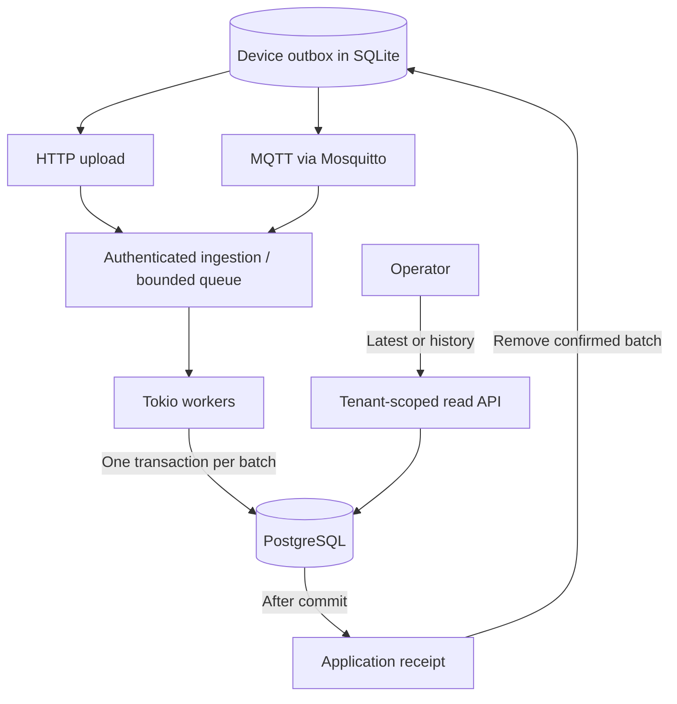
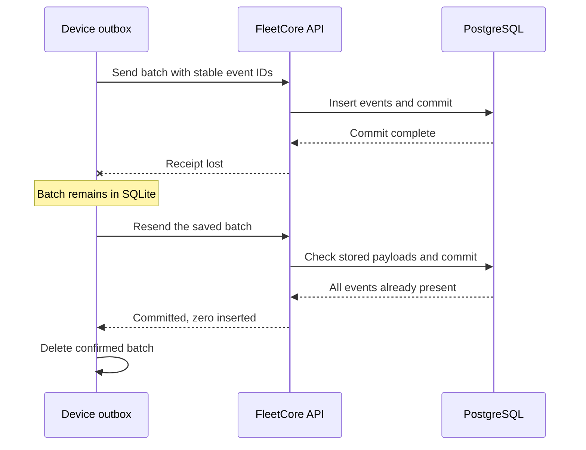
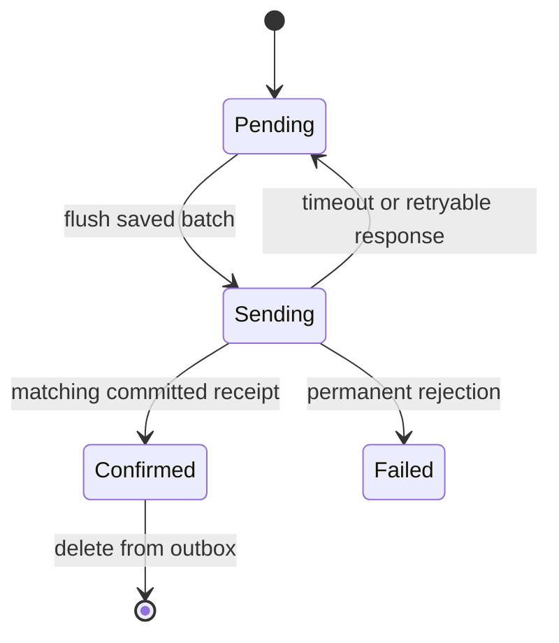
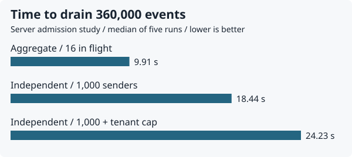

# FleetCore | Offline vehicle telemetry in Rust

[](https://github.com/Jappynathaniel/FleetCore/actions/workflows/ci.yml)
[](LICENSE)

A van goes offline, records its route, and reconnects hours later. FleetCore lets it upload those observations over HTTP or MQTT, safely resend a batch if the reply disappears, and query the route in observation order. Each device keeps a durable **outbox** in SQLite. It deletes a batch only after FleetCore returns a **receipt** confirming the PostgreSQL commit.

**Try the outage demo** from the repository root with Docker Compose v2, BuildKit and a POSIX shell (WSL on Windows).

```sh
sh scripts/demo.sh
```

## How a sample reaches storage



| What can go wrong? | How FleetCore handles it | Executable check |
| --- | --- | --- |
| The reply disappears after commit | A retry carries the original event IDs. Each matching event counts as a duplicate and occupies one row. | [Lose an MQTT receipt, then retry over HTTP](src/bin/acceptance.rs#L198-L232) |
| A sender reuses an ID with different data | The writer compares payloads within the transaction. A conflict rolls back even the new events in that batch. | [Check the conflict and the absent row](src/bin/acceptance.rs#L133-L150) |
| PostgreSQL dies during an insert | The unconfirmed batch stays with the sender. After restart it can replay the batch and verify the receipt. | [Kill the database and reconcile every stored field](scripts/crash_replay.py) |
| Devices reconnect faster than the writer can commit | A bounded queue and a limit on active workers cap pending write work. A full queue returns HTTP 429 or an MQTT busy receipt. | [Hold the writer and saturate the queue](src/bin/acceptance.rs#L253-L283) |
| One tenant requests another tenant's data | HTTP reads use the operator's tenant. The MQTT broker restricts each device's publish topic. | [Cross-tenant read](src/bin/acceptance.rs#L120), [cross-device publish](src/bin/acceptance.rs#L213-L237) |
| An old observation arrives late | Latest state and paginated history order by observation time, with event ID breaking ties. | [Insert an older sample over MQTT and query latest](src/bin/acceptance.rs#L152-L180) |

## When the receipt disappears

MQTT QoS 1 acknowledges delivery to the broker. The device still needs to know whether the database committed. The hardest case is a successful commit followed by silence.



<details>
<summary>What happens after a timeout, overload or permanent rejection?</summary>



After a retryable failure the simulator backs off with jitter and honors the HTTP retry minimum. Exhausting the attempt budget leaves the batch pending for a future flush. A permanent rejection, such as HTTP 409 for a changed payload, records the reason in SQLite. Later flushes skip that row and report the unresolved failure. [Simulator flush loop](src/bin/simulator.rs#L224-L269)

</details>

## Run and inspect the demo

The demo sends three observations over HTTP, stops the API, records five more, and attempts an upload. Look for the pending batch while the API is down. A fresh simulator container then uses the same SQLite volume to replay it over MQTT. The final inspection queries the stored vehicle data. [Demo script](scripts/demo.sh)

<details>
<summary>Run individual steps and inspect the interfaces</summary>

```sh
docker compose up -d --build --wait api prometheus
docker compose run --rm simulator generate --events 3
docker compose run --rm simulator flush --via http
docker compose run --rm simulator status
docker compose run --rm simulator inspect
docker compose down
```

The API and its metrics endpoint are on `localhost:8080`. Prometheus is on `localhost:9090`. Compose provides local demo credentials and plaintext listeners. The north device uses ID `north-van` and token `north-van-demo`. Its operator uses `north-operator-demo`. HTTP uses bearer tokens. MQTT uses the device ID and device token. Stopping Compose with the command above preserves the volumes.

| Interface | Contract |
| --- | --- |
| `POST /v1/telemetry/batches` | Send a JSON object with a UUID `batch_id` and 1 to 10,000 events, up to 2 MiB. |
| `devices/{device_id}/telemetry` | Publish the same JSON at QoS 1. Receive application receipts on `devices/{device_id}/receipts`. |
| `GET /v1/vehicles/{device_id}/latest` | Fetch the newest observation. An empty history returns HTTP 204. |
| `GET /v1/vehicles/{device_id}/telemetry?limit=100` | Read newest first. Pass the returned `next_cursor` as `cursor` for the next page. |

Each event carries a UUID `event_id`, observation time `observed_at_ms`, coordinates `latitude_e6` and `longitude_e6`, and speed `speed_cm_s`. A committed receipt includes the batch ID and counts of inserted and duplicate distinct IDs. [Protocol types](src/protocol.rs)

</details>

## What changed after measurement?

**One uploader recovered faster with fewer sends in flight.** With 1,000 simulated devices replaying 360,000 events over HTTP, reducing the aggregate limit from 96 to 16 cut median drain time from **14.99 s to 10.31 s** across ten paired trials (31.2%). Drain time measures how long the fleet takes to clear its backlog. A frozen holdout with 2,000 devices and 480,000 events saw a 27.8% reduction.

**Independent devices behaved differently.** The next experiment gave each of 1,000 devices its own sender and tested a server cap of 16 active batches, eight per tenant. Over five alternating repetitions, the policy increased both drain time and retries. It also missed the quiet tenant's latency target in all three noisy-neighbor trials. Admission stays opt-in.



**Batch size changed the writer choice.** Staged binary COPY cut median drain time by 17.8% for one million events in 10,000-event batches. Prepared UNNEST won the 360,000-event reconnect comparison and remains the default.

All three studies used synthetic traffic, one API instance and one PostgreSQL instance. Each had a two-CPU limit, with 768 MiB for the API and 1 GiB for PostgreSQL. Each comparison uses its own session's control. The measurement notes include the paired interval, both latency clocks, failed gates, soak and outage results, and reproduction commands. [Measurements and limits](docs/measurements.md)

## Rust implementation decisions

| Decision | Operational consequence |
| --- | --- |
| Authenticate HTTP before buffering the body, then enforce a three-second body-read deadline. | Slow uploads have a bounded time to finish after their headers arrive. [HTTP transport](src/transport.rs) |
| Send jobs through a bounded Tokio channel. A semaphore limits concurrent persistence tasks. | Queue capacity and database concurrency can be tuned separately. [Dispatcher](src/service.rs) |
| Carry the experimental admission permit with the job. HTTP waits on a one-shot channel for its receipt. | A disconnected client cannot free a slot while its write is still running. [Permit lifetime check](src/bin/acceptance.rs#L338-L389) |
| Close the queue on shutdown and join accepted work within a 25-second drain deadline. | Workers get time to finish. A device whose receipt never arrives retains its batch for replay. [Shutdown](src/main.rs#L137-L160) |

## Verify the guarantees

Run the same four disposable configurations as CI with Docker Compose, a POSIX shell and Python 3. The harness tests prepared UNNEST and staged COPY, each with tenant admission on and off. It creates and removes its own Compose projects and volumes.

```sh
sh scripts/ci_acceptance.sh
```

The crash test waits until PostgreSQL is executing a known insert, kills the process, and verifies that the pre-crash table is intact after restart. Replaying the saved 32 events must insert all 32. Replaying them again must report 32 duplicates. Both passes compare every stored field. This covers a database process crash on persistent storage. Disk loss and replica failover remain outside the tested scope. [Crash harness](scripts/crash_replay.py) · [Passing four-configuration run](https://github.com/Jappynathaniel/FleetCore/actions/runs/44758615934)

<details>
<summary>Local Rust checks and source map</summary>

With Rust 1.95.0, rustfmt and Clippy installed:

```sh
cargo fmt --all --check
cargo clippy --locked --all-targets --all-features -- -D warnings
cargo test --locked --all-targets --all-features
cargo test --locked --doc
```

| Start here | What to look for |
| --- | --- |
| [Transport](src/transport.rs), [ingestion](src/service.rs), [storage](src/store.rs) | Follow a batch from authentication through a commit and its receipt. |
| [Simulator](src/bin/simulator.rs), [client](src/client.rs) | Trace a saved batch across retries and transport changes. |
| [Migrations](migrations), [deployment configuration](deploy) | Inspect the event key, history index, broker ACL and monitoring setup. |
| [Benchmark runner](src/bin/benchmark.rs), [experiment scripts](scripts), [benchmark Compose stack](compose.bench.yaml) | Inspect workloads, resource limits and reconciliation. |
| [CI workflow](.github/workflows/ci.yml) | See the lint, unit and end-to-end checks required on pushes and pull requests. |

</details>
